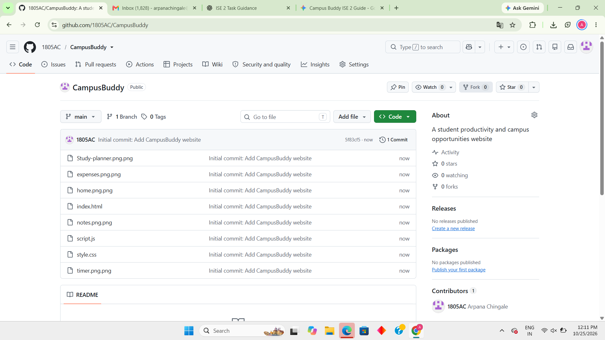
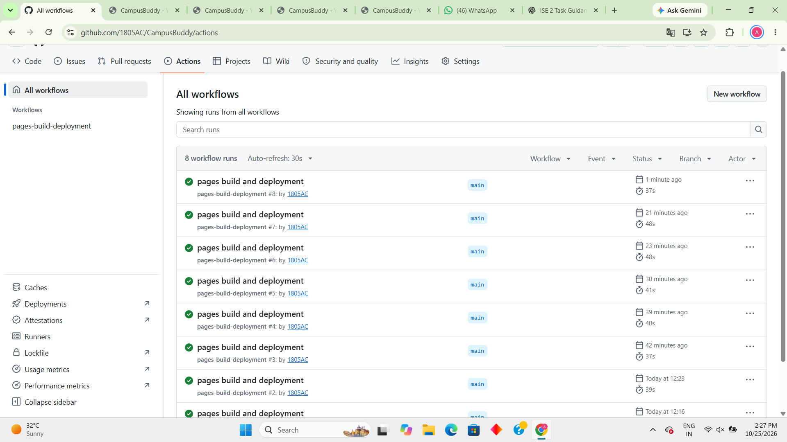
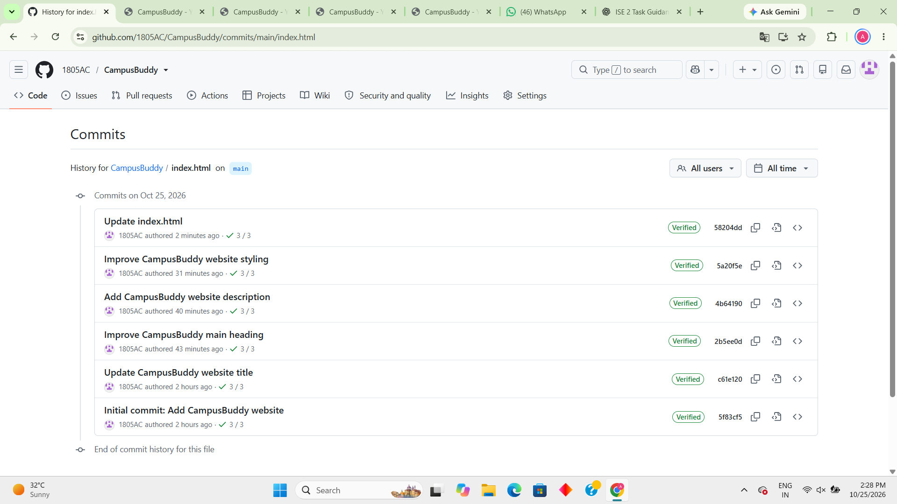

# Campus Buddy

## 1. Project Introduction

**Campus Buddy** is a simple website project created to provide a basic web presence for a campus-related service. This project demonstrates front-end web development, version control, and website deployment using GitHub tools.

## 2. Project Objective

The main objectives of this project are:

- To create a basic and user-friendly website.
- To learn HTML, CSS, and JavaScript.
- To understand version control using Git and GitHub.
- To track project improvements through multiple commits.
- To automate website deployment using GitHub Actions.
- To host the website using GitHub Pages.

## 3. Important Links

- **GitHub Repository:** https://github.com/1805AC/CampusBuddy
- **Live Website:** https://1805ac.github.io/CampusBuddy/
- **GitHub Actions:** https://github.com/1805AC/CampusBuddy/actions/runs/40180464582
- **Commit History:** https://github.com/1805AC/CampusBuddy/commits/main/
- **GitHub Pages Settings:** https://github.com/1805AC/CampusBuddy/settings/pages
- **Project Workflow File:** https://github.com/1805AC/CampusBuddy/blob/main/.github/workflows/pages.yml


## 4. Technology Stack

| Technology / Tool | Purpose |
|---|---|
| HTML | Creates the structure of the website. |
| CSS | Controls the website's styling and appearance. |
| JavaScript | Supports client-side functionality. |
| Git | Tracks code changes and project history. |
| GitHub | Hosts the repository and supports version control. |
| GitHub Actions | Automates the website deployment workflow. |
| GitHub Pages | Publishes the website online. |

## 5. Repository Details

- **Project Name:** Campus Buddy
- **Repository:** https://github.com/1805AC/CampusBuddy
- **Repository Owner:** `1805AC`
- **Main Branch:** `main`
- **Website Entry File:** `index.html`
- **Styling File:** CSS file in the repository
- **JavaScript File:** `script.js`
- **Deployment Platform:** GitHub Pages
- **Automation Tool:** GitHub Actions

## 6. Project Setup and Execution

### Prerequisites

- A web browser such as Google Chrome, Firefox, or Microsoft Edge.
- Git, if you want to clone the repository and use Git commands.
- A code editor such as Visual Studio Code (optional).

### Step 1: Clone the Repository

```bash
git clone https://github.com/1805AC/CampusBuddy.git
```

### Step 2: Open the Project Folder

```bash
cd CampusBuddy
```

### Step 3: Run the Website Locally

Open `index.html` in your web browser.

Alternatively, open the project folder in Visual Studio Code and use a local development server if one is available.

**Note:** No backend server or package installation is required for a basic local preview of this front-end project.

## 7. Changes Made and Commit Details

The following six commit messages are recorded in the repository history.

| No. | Commit Message | Description |
|---|---|---|
| 1 | `Initial commit: Add CampusBuddy website` | Added the initial Campus Buddy website files. |
| 2 | `Update CampusBuddy website title` | Updated the website title. |
| 3 | `Improve CampusBuddy main heading` | Improved the main heading displayed on the website. |
| 4 | `Add CampusBuddy website description` | Added a description to explain the website. |
| 5 | `Improve CampusBuddy website styling` | Improved the website's visual styling. |
| 6 | `Update index.html` | Updated the main HTML file. |

https://github.com/1805AC/CampusBuddy/commits/main

These commits demonstrate incremental development and the use of Git to maintain a history of project changes.

## 8. Git and GitHub Workflow

Git was used to track changes to the website, while GitHub was used to store the repository and maintain the commit history.

### Basic Git Commands

Check the current repository status:

```bash
git status
```

View the commit history:

```bash
git log --oneline
```

Stage the README file:

```bash
git add README.md
```

Commit the README file:

```bash
git commit -m "Add project README documentation"
```

Push the commit to GitHub:

```bash
git push origin main
```

### Workflow Followed

1. Create and maintain the website files.
2. Make changes to the HTML, CSS, and JavaScript files.
3. Use Git to track and commit changes.
4. Push commits to the GitHub `main` branch.
5. Use GitHub Actions to run the deployment workflow.
6. Publish the website through GitHub Pages.
7. Verify the deployed website in a browser.

## 9. DevOps Integration Using GitHub Actions

GitHub Actions was integrated into the project to automate website deployment.

### Integration Steps

1. Open the https://github.com/1805AC/CampusBuddy
2. Verify the workflow file at .github/workflows/pages.yml
3. Configure the workflow to run when changes are pushed to the `main` branch.
4. Add a checkout step to access the repository files.
5. Configure GitHub Pages for deployment.
6. Upload the website files as a Pages artifact.
7. Deploy the artifact to GitHub Pages.
8. Open the [Actions tab](https://github.com/1805AC/CampusBuddy/actions/runs/40180464582) and verify that the workflow completes successfully.
9. Open [GitHub Pages Settings](https://github.com/1805AC/CampusBuddy/settings/pages) and verify that the deployment source is GitHub Actions.
10. Open the live website and confirm that it loads correctly.

### DevOps Workflow

```text
Developer changes website files
             |
             v
       Git commit
             |
             v
       Push to GitHub
             |
             v
      GitHub Actions
             |
             v
    Upload website files
             |
             v
      Deploy to Pages
             |
             v
       Live website
```

This demonstrates a basic Continuous Integration/Continuous Deployment (CI/CD) workflow by automating deployment after changes are pushed to GitHub.

## 10. Screenshots and Proof of Work

The `screenshots/` folder contains images documenting the website, repository, commit history, and deployment workflow.

Ensure the image filenames below match the actual files in your repository.

### 1. Campus Buddy Website

**File:** 'screenshots/screenshots/home.png.png'

[Campus Buddy website screenshot](screenshots/screenshots/home.png.png)

This screenshot demonstrates the website's appearance in a browser, including its layout, main heading, description, and styling.

[View website screenshot in the repository](https://1805ac.github.io/CampusBuddy/)

### 2. GitHub Repository

**File:** `screenshots/screenshots/repository.png.png`



This screenshot provides evidence of the project files stored in GitHub and demonstrates repository organization.

[Open the GitHub repository](https://github.com/1805AC/CampusBuddy)

### 3. GitHub Actions Workflow

**File:** 'screenshots/screenshots/actions.png.png'



This screenshot provides evidence of the deployment workflow and its execution status.

[View GitHub Actions runs](https://github.com/1805AC/CampusBuddy/actions/runs/40180464582)

### 4. Git Commit History

**File:** 'screenshots/screenshots/commit.png.png'



This screenshot demonstrates the project's incremental development through multiple commits.

[View commit history](https://github.com/1805AC/CampusBuddy/commits/main/)


## 11. Project Outcome

The Campus Buddy project demonstrates:

- Front-end website development.
- Source code management using Git and GitHub.
- Tracking changes through multiple commits.
- Automated deployment using GitHub Actions.
- Website hosting using GitHub Pages.
- Documentation of project development and deployment evidence.

## 12. Conclusion
Campus Buddy provides practical experience in front-end web development, version control, repository management, and automated website deployment. The project connects website development with DevOps concepts by using GitHub Actions and GitHub Pages to publish the website.


Campus Buddy provides practical experience in front-end web development, version control, repository management, and automated website deployment. The project connects website development with DevOps concepts by using GitHub Actions and GitHub Pages to publish the website.

